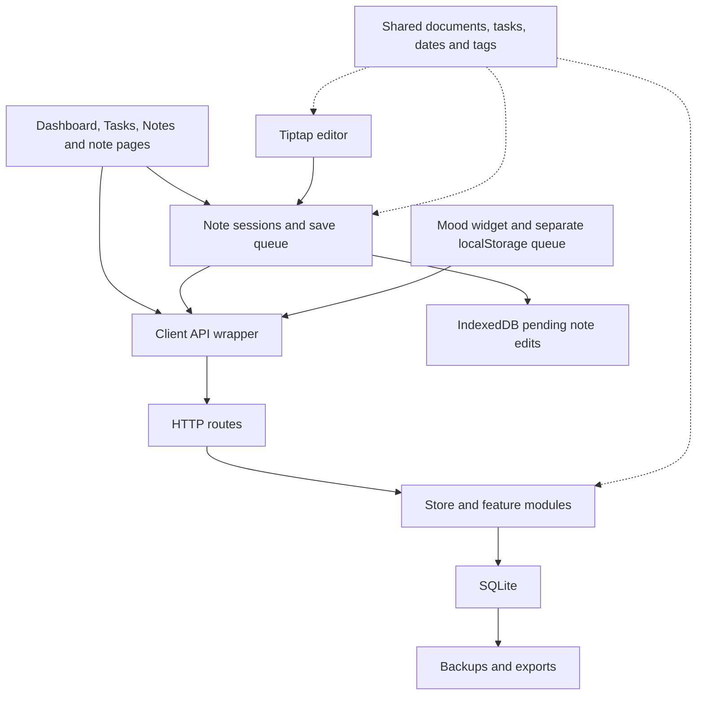

# Architecture audit — 2026-10-12

Reviewed checkout: `92b0dbe`, application 0.4.4. This supersedes the source-version scope of the earlier quick audit, which reviewed 0.4.3. Security is excluded at the owner's request. No application behavior, schema, live data, network configuration or deployment was changed. Existing documentation changes were preserved.

## Overall assessment

The stack is appropriate for a personal app. SQLite, Preact, Tiptap and a small HTTP server do not need replacement. The key design choices are sound: a note is the unit of persistence and conflict handling; tasks belong to that note's document; note/task IDs survive edits; saves continue outside component lifetimes; migrations and verified backups support recovery.

The principal maintenance risk is overlapping ownership. A screen often owns both presentation and a separate fetched projection of data, then must also coordinate with a Session and sometimes a live editor. Some rules are shared already, but document validity, queued-write errors and task mutations are not consistently enforced across all entry points.

## Current architecture

- **Persistence:** `server/db.js` provides migrations and transaction helpers. Note documents are JSON; tag membership is relational; tasks are nodes in documents; moods have their own table. Do not introduce a second authoritative copy of task text.
- **Server behavior:** `server/store.js` combines queries, note creation/saving, revision checks, snapshots, tag movement, settings and assistant editing. `server/app.js` registers routes, translates errors and serves static assets. Mood operations are separate; portability accesses the database directly.
- **Editing:** `NoteEditor` attaches a document provider and task callbacks to a Session. Commands use ProseMirror transactions while the editor is open, preserving undo. Without an editor, Session uses JSON task transformations.
- **Saving:** Session tracks revisions, dirty/captured sequence numbers, in-flight operation IDs, pending content, conflicts and retries. IndexedDB records retain unconfirmed edits. Successful replies update bookkeeping without resetting the editor.
- **Read views:** Stream renders Session-backed notes. Notes and Tasks hold fetched arrays in component state. Tasks separately patches its array optimistically and writes through Session. This creates a projection that must be kept consistent with both server state and local pending edits.
- **Dashboard:** widgets reuse existing components, which is useful. Widget metadata and component registration live in separate files. Today's note also owns fetching, note selection, source-tag changes and editor activation.
- **Recovery:** backup snapshots cover the database; JSON exports carry notes, versions, tags, settings and moods. Import has its own validation and merge/replace logic. This is a critical boundary for future attachments.

## Confirmed functional gaps

### Queued moods can be discarded without being saved

Location: `client/src/moods.js:44–56`.

`flushMoods` treats every `ApiError` as permanently unacceptable. It then removes the record and increments the sent count. A temporary HTTP 503 and an HTTP 401 indicating an expired session both remove an unconfirmed entry. A synthetic probe reproduced both behaviors without accessing any live data.

Change: distinguish retryable server failures, a paused queue awaiting login, confirmed success, and a permanently invalid record. Keep invalid records visible with an actionable error rather than silently deleting them. Share error classification and durable-storage primitives with note saving, while keeping the two features' different protocols separate. Surface storage failures instead of reporting durable recovery when only memory succeeded.

Acceptance: a 503 preserves the record across reload; expired-session recovery resumes it after login; only a successful acknowledgment removes it; permanent validation errors remain visible without blocking unrelated records.

### Server document validation is weaker than the editor's schema

Locations: `shared/doc.js:40`, `server/store.js:602`, editor schema in `client/src/editor/extensions.js`.

The shared validator checks recognized node names and some attributes but not the allowed parent/child structure. A paragraph containing another paragraph passes `validateDoc`, is accepted by `Store.saveNote` in an in-memory database, and fails the editor schema's `check()`. This is a compatibility problem for imports and future document features. The probe establishes acceptance of incompatible content; it does not establish that ordinary UI typing generates such content or that text was lost.

Change: define the supported document structure in an independent shared contract. Validate allowed children and required structure on save/import. Use fixture-based parity checks against the editor schema and the static/Markdown renderers. Keep the server independent of browser-only editor code.

Acceptance: every accepted document fixture is representable by the editor; invalid nesting is rejected; old formats migrate deliberately; supported fixtures round-trip through save, export/import and reopening without content loss.

## Changes I would make, in order

### 1. Establish clear ownership for client data

Start with Tasks, where this is already a demonstrated problem. `Tasks.jsx:89–100` loads a task snapshot on mount; `:101–139` independently patches that snapshot and mutates a Session. It does not subscribe to Session document changes or refresh its task data on focus. The earlier 0.4.3 browser audit reproduced stale tasks after a remote save and refocus; these relevant paths remain present in 0.4.4, though that browser reproduction was not repeated in this audit.

Introduce a small observable data layer with query-specific refresh rules. Keep Session authoritative for local note edits. Derive loaded-note tasks from local Session content, and combine them with fetched tasks from notes not loaded locally. Refresh affected queries after successful writes, tag moves, imports and restore operations, and on focus/reconnect. Preserve pending edits and the existing rule against advancing an open editor's revision silently.

Emit targeted events such as note-content-changed and note-saved; avoid rerendering every screen on every status tick. Refetch summaries without rebuilding a live editor. Keep display state—expanded rows, menus, selected filters—in components.

### 2. Put mutations behind a small command interface

Examples of mixed ownership: `TagEditor.jsx:59,75` assigns `session.tags` directly, while `NoteEditor.jsx:150–155` assigns and clears task callback fields. Screen components fetch notes, adopt Sessions and decide how to modify documents themselves.

Expose explicit commands for changing task attributes/text, changing tags, trashing and restoring. Commands coordinate Session, the optional editor adapter, durable saves and query refresh. Replace public callback assignments with an attach/detach editor adapter whose capabilities are explicit.

Keep separate JSON and ProseMirror implementations where needed. Share semantic decisions such as dismissal/completion rules and timestamp behavior; the editor implementation must still preserve selection and one-step undo. Add parity checks between these paths rather than converting every editor operation into whole-document replacement.

### 3. Separate controllers from presentation in the largest views

`Tasks.jsx` owns networking, optimistic changes, scheduling/grouping, ranges, menus, inline editing and row rendering. `Stream.jsx` exports the reusable `NoteCard` alongside stream loading and navigation. NotePage and Today import that card from the stream feature. Today's note widget handles loading, tags and editor selection inside the dashboard module.

Extract the reusable NoteCard into a notes component, move query/edit coordination into controllers or hooks, and make task grouping a pure function. Separate dashboard task scope from task fetching and commands. Consolidate widget registration so metadata and rendering do not need parallel updates.

Success means a layout change can be made in a view without touching save/retry behavior, and a task-rule change can be tested without mounting the dashboard.

### 4. Make list loading consistent

Notes, People, Stream and EarlierNotes each implement their own fetching/paging state. Notes has no in-flight pagination guard (`Notes.jsx:59,142`), which the earlier audit reproduced as duplicate rows. Stream deduplicates displayed entries with a Map, but still has a separate pagination implementation. EarlierNotes has a loading flag and different paging rules.

Extract a small reusable request helper for cancellation/generation tracking, errors, retry, loading flags and deduplication. Keep feature-specific cursor rules: notes use an offset; streams page by whole days. Do not force them into one cursor algorithm. Add checks for double taps, late replies after a filter/tag change, and reconnects.

### 5. Give the server clearer feature boundaries

Separate note persistence/querying, tag operations, settings and assistant commands gradually. The existing Store can remain a facade while modules move underneath it. Keep note saving, revision handling and snapshots in one transaction boundary. Assistant edits should continue using that same save path.

Move `HttpError` and generic ID checks out of Store: unrelated modules such as moods and portability import them from the note store today. Group route registration by feature while retaining the existing HTTP implementation. Centralize settings serialization so normal settings updates and import use consistent rules.

This is organizational work, not evidence that SQLite or the HTTP server is inadequate. There is no demonstrated need for microservices, a different database, or a new server framework.

### 6. Make the save engine easier to test before changing it

`sync.js` imports a global API/storage and installs browser lifecycle listeners itself. Its Session combines editor attachment, local durability, retry scheduling, remote saves and conflict resolution. Existing browser resilience tests exercise important behavior, but the dedicated sync unit suite has six tests focused primarily on adoption and drafts.

Allow the manager/session to receive API, storage, clock and scheduling dependencies. Model save transitions explicitly and test them with controlled deferred responses and storage failures. Cover newer typing during a save, a lost reply, retries, conflict resolution, failed storage, detach during capture and acknowledgment order. Reuse these invariants when extracting internals.

Keep the existing behavior first. Split responsibilities only after those tests pin down the protocol; a broad replacement would put the app's strongest feature at unnecessary risk.

## Attachment design implications

Attachments require a storage/recovery design as well as an editor button. Start with stable attachment IDs, metadata in SQLite, and binary files in an app-managed directory. If references are embedded as new document nodes, update the document format/migration contract, editor schema, static renderer and exports together.

Define uploading/failed/ready states, and keep a file recoverable until its references are confirmed. Backup and restore must include both database metadata and the corresponding binaries in one verifiable bundle. Preserve files referenced by note versions and trash, so restoring an older note still works. Specify JSON/Markdown export behavior explicitly; the current JSON export and SQLite-only backup do not contain binary assets.

Implement ordinary online uploads first if offline attachment capture is deferred, and clearly expose that limitation. Do not imply that pending file contents are protected by the existing note-text outbox.

## Validation and limits

- Current 0.4.4 server/client suite: **114/114 passed** outside the sandbox so tests could reach their temporary local servers.
- Synthetic probes confirmed mood removal after 503/401 and acceptance of editor-invalid nesting. They use mocked responses, fictional entries and an in-memory database.
- Current 0.4.4 production build passed. Main JavaScript is 541.72 kB minified / 171.67 kB gzip and triggers Vite's chunk-size warning. No loading-time benchmark was performed.
- This is a focused architecture/code audit across client state, views, editor adapters, shared rules, server persistence, migrations and portability. It is not a complete browser suite, a live deployment inspection, a performance benchmark or a real-phone review.
- Architecture documentation is behind the implementation: it still describes roughly 15 routes and predates some current settings/features. Refresh it as boundaries change.
- Probe source and check logs live in ignored `data/architecture-audit-2026-10-12`. Existing setup and recovery instructions remain applicable; this audit needs no rollback.

Recommended first tranche: fix queued-write error handling and document validation, then unify Tasks data/commands with focused regression checks. Extract views and server modules incrementally afterward. Add attachments against explicit document and recovery contracts.
